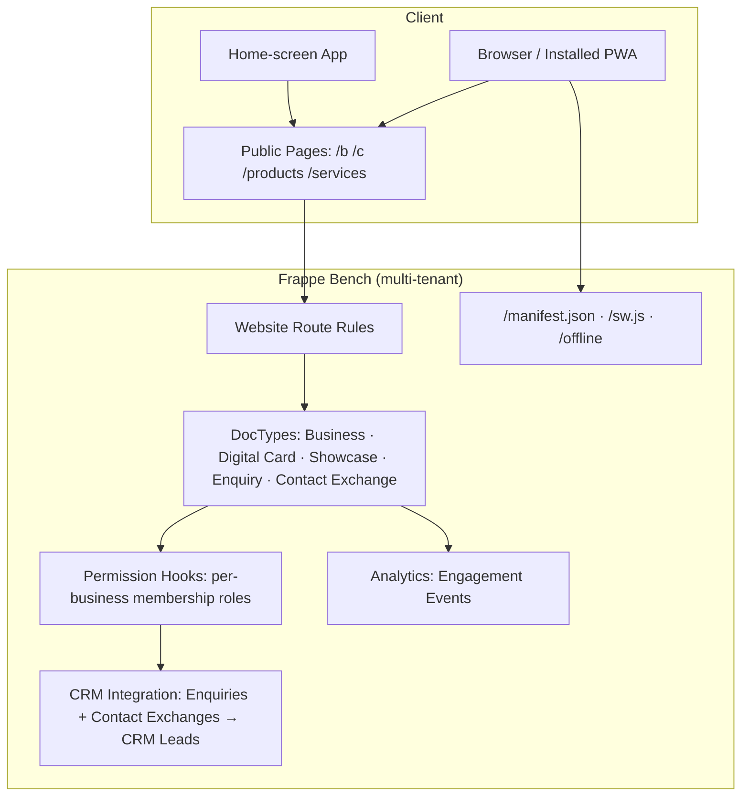

# OSDuo Business Connect

**v1.2.6** | **Your digital identity. Your customers. Your growth.**

Business Connect transforms how small businesses and professionals establish their digital presence. Create a stunning business profile, showcase products and services, capture customer enquiries and card exchanges, and install it all as a mobile app — all seamlessly integrated with Frappe CRM.

---

## What It Does

| Capability | Description |
|------------|-------------|
| **Digital Business Card** | Mobile-first card with VCF download, QR/NFC sharing, and 6 distinct templates |
| **Business Profile** | Public landing page with hero, about, products, services, hours, and contact |
| **Product Showcase** | Product catalog with categories, galleries, pricing, and brochures |
| **Service Listings** | Service pages with features, locations, and descriptions |
| **Lead Generation** | Enquiry forms and card exchanges that auto-create Enquiries, then CRM leads with full tracking |
| **Contact Exchange** | Owner records who a card/business/product was shared with at events — saved as an Enquiry, appears in CRM with the message context |
| **Universal Share Bar** | Copy / WhatsApp / SMS / Email / native share on every public page, all attributed with `?ref=` + sharer |
| **My Card** | `/my-card` lists your published cards with one-tap Open, plus desk navbar / analytics entry points and an Open button beside Public URL in the desk forms |
| **Analytics Dashboard** | Real-time engagement metrics — visits, scans, top cards, visitor mix, enquiry pipeline |
| **Mobile App (PWA)** | Every customer site installs as a branded app — offline card pages, home-screen icon |
| **Multi-Tenant SaaS** | One bench serves many customers on `customer.connect.domain.com` + bring-your-own domains |

---

## How It Works

```
Customer taps NFC / scans QR
         ↓

Business Connect Web App (installable PWA) → Profile loaded from database → Template rendered
         ↓
Customer fills enquiry form → Lead auto-created in Frappe CRM (with full tracking)
         ↓
Analytics Dashboard updates with real-time metrics
```

---

## Key Features

### Dynamic Card Generation
- **6 card templates** — Professional, Modern, Minimal, Classic, Luxury, Creative
- **QR code & NFC enabled** — QR auto-generated from the canonical public URL
- **VCF download** — complete digital business card sharing
- **Stable URLs** — the public slug locks on submit and survives cancel → amend, so printed
  QR codes and NFC tags never silently break

### Business Profile Management
- **Hero with real variants** — six distinct band/nav designs; cover image renders as a
  full-bleed banner behind the hero
- **About, products, services, business hours, contact, enquiry form** on the public page
- **Team members** — owner membership auto-created; add managers, marketing, members
- **Contact methods & social links** with sanitized public rendering

### Product Showcase & Service Listings
- Catalog with categories, galleries, pricing modes, brochures, and video embeds
- Detail pages inherit the parent business theme and header

### Theming & Branding
- **BC Theme**: template + layout + color scheme (Violet, Indigo, Blue, Green, Yellow, Orange,
  Red, Gold + custom) with automatic contrast correction and dark mode
- New businesses auto-link the built-in **Default Blue** theme
- **Bundled logos**: login, desk/app screen and PWA icons all use brand assets that ship
  in the app (`public/images/`) — no copying logo files into each site's `public/files`;
  `bench migrate` applies the defaults and per-site uploads still override them
- **Default Website Theme**: `OSDuo Business Connect` ships with the app and is created +
  selected on install/migrate, together with the favicon, app logo and app name. Existing
  theme customisations and deliberate per-site theme choices are preserved

### Lead Generation Engine
- Enquiry forms capture visitor details and auto-create **Enquiries** that sync to
  Frappe CRM leads with source, UTM campaign, landing-URL tracking and the message
  carried onto the lead (`OSDuo Message`)
- **Contact Exchange (v1.2.5)** — a card handed over at an exhibition is recorded with
  the channel (WhatsApp/SMS/Email/In-person), event and notes; the CRM Lead keeps the
  context, and the "OSDuo Attribution" fields show on the CRM Lead side panel
  automatically
- Enquiry pipeline with statuses and responses

### Analytics Dashboard
- Visits, card scans, engagement events (call/WhatsApp/email/share-open/brochure
  clicks), top cards, enquiry pipeline — real-time, guest-safe client-side tracking
- **Visitor classification (v1.2.5)** — every event is stamped Guest / Owner / Member /
  Other User / Unknown from the live session; the dashboard shows the visitor mix and
  can exclude owner/member views so team testing doesn't inflate numbers

### Progressive Web App (v1.2.0)
- `/manifest.json` — dynamic per-site app name, icons, and theme colors
- `/sw.js` — offline viewing of previously visited public pages, smart cache strategy
  (API and desk traffic never cached), automatic update roll-forward
- `/offline` — branded fallback page
- Android install prompt + iOS "Add to Home Screen" guidance on the login app entry
- See **[docs/PWA.md](docs/PWA.md)**

### Sharing, Attribution & My Card (v1.2.5)
- Canonical public URLs for QR/NFC safety — `host_name` honoured with its explicit
  scheme; scheme-less public hosts read as `https://` (no dev port on real domains)
- Share links carry `?ref=share_*&by=<sharer's card slug>`; opening one logs a
  server-side `shared_link_open` event per channel
- `/my-card` page with one-tap card opening attributed by `?ref=mycard`; desk "Open"
  button directly beside the Public URL on all profile forms (v1.2.6)

---

## Getting Started

### Prerequisites
- Frappe Framework **v16** (`>=16.0.0,<17.0.0`) and a working bench
- **Frappe CRM** (required dependency)
- Python 3.10+, Node.js/Yarn, MariaDB, Redis
- `qrcode[pil]` for QR generation: `bench pip install "qrcode[pil]"`

### Quick Install (single site)

```bash
bench init frappe-bench --frappe-branch version-16 && cd frappe-bench
bench new-site mysite.local
bench get-app https://github.com/devosduotech/osduo_business_connect.git
bench --site mysite.local install-app osduo_business_connect crm
bench --site mysite.local migrate
```

Then set the canonical domain in `sites/mysite.local/site_config.json` and restart:

```json
{ "host_name": "https://mysite.example.com" }
```

Full walkthrough — including **multi-tenant SaaS provisioning** (wildcard DNS, wildcard
TLS, per-customer sites, bring-your-own domains) and the update procedure:
**[docs/INSTALLATION_GUIDE.md](docs/INSTALLATION_GUIDE.md)**

---

## Documentation

| Document | Audience | Contents |
|---|---|---|
| [User Manual](docs/USER_MANUAL.md) | End users & admins | Businesses, cards, products, services, theming, publishing, enquiries, analytics, roles, mobile app |
| [Installation Guide](docs/INSTALLATION_GUIDE.md) | Operators | Fresh install, SaaS multi-site setup, BYOD domains, updates, troubleshooting |
| [PWA](docs/PWA.md) | Operators & devs | Manifest/service-worker architecture, caching strategy, canonical URL policy, testing |
| [SaaS Implementation Plan](docs/SAAS_IMPLEMENTATION_PLAN.md) | Product | Tiers, quotas, SEO engine — planned capabilities |
| [Theme Redesign Plan](docs/THEME_REDESIGN_PLAN.md) | Designers | Design system behind the public pages |
| [Marketing Features](docs/MARKETING_FEATURES.md) | Sales | Feature & benefit catalogue |
| [Marketing Feature Inventory](docs/MARKETING_FEATURE_INVENTORY.md) | Sales & product | Every shipped capability with evidence, plus the prioritized v1.3.0 scope |
| [Pending To-Do List](docs/TODO.md) | Team | Single working list: next release, backlog, tech debt, doc cleanups |
| [Release Notes](RELEASE_NOTES.md) / [Changelog](CHANGELOG.md) | Everyone | What shipped in each version |
| [SEO Plan](docs/SEO_PLAN_v1.3.0.md) | Team | Committed v1.3.0 SEO scope with recommended work order |

---

## Architecture Overview



Security model: Business / Digital Card / Product / Service are **submittable** records;
public pages only serve Published + non-cancelled documents; rich text is sanitized on
save; all outbound links pass through `safe_url`; per-business data isolation is enforced
by `has_permission` + permission query conditions.

---

## Development Roadmap

For the full pending to-do list (next release scope, backlog, tech debt and
documentation cleanups), see **[docs/TODO.md](docs/TODO.md)**.

- [x] Core business profile creation
- [x] Dynamic card generation with multiple templates
- [x] Frappe CRM integration for lead management
- [x] Analytics dashboard with real-time metrics
- [x] Mobile delivery via installable PWA (v1.2.0)
- [x] Multi-tenant SaaS domain model (hosted subdomains + BYOD)
- [x] Universal share bar + channel/sharer attribution (v1.2.5)
- [x] Contact Exchange — event lead capture → Enquiry → CRM (v1.2.5)
- [x] Visitor classification & visitor-mix analytics (v1.2.5)
- [x] My Card: `/my-card`, desk navbar, Open buttons beside Public URL (v1.2.5/1.2.6)
- [x] Buy Here purchase links on products/services (v1.2.7) — per-item override +
      business default + analytics
- [x] Featured badges & featured-first ordering on all listings (v1.2.7)
- [ ] SEO engine — v1.3.0 scope committed and prioritized (canonical/OG, JSON-LD,
      sitemap, catalogue SEO fields, web vitals, brand attribution) — see
      [docs/TODO.md](docs/TODO.md) §1
- [ ] SaaS tiers & quotas (`BC Subscription`)
- [ ] Web push notifications for installed PWAs
- [ ] Play Store listing via TWA wrappers
- [ ] Multi-language support

---

## Support & Contribution

For technical support, open an issue on the GitHub repository. For feature requests or bug reports, please use the appropriate issue template.

Contributions welcome! Review our contribution guidelines before submitting PRs.

---

**© 2026 OSDuo Technologies** | Licensed under MIT
