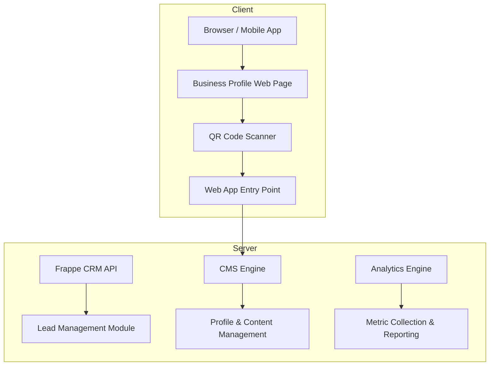

# OSDuo Business Connect

**v1.0.2** | **Your digital identity. Your customers. Your growth.**

Business Connect transforms how small businesses and professionals establish their digital presence. Create a stunning business profile, showcase products and services, capture customer enquiries — all seamlessly integrated with Frappe CRM.

---

## What It Does

| Capability | Description |
|------------|-------------|
| **Digital Business Card** | Mobile-first card with VCF download, QR/NFC sharing, and 6 distinct templates |
| **Business Profile** | Public landing page with hero, about, products, services, gallery, and contact |
| **Product Showcase** | Product catalog with categories, galleries, pricing, and brochures |
| **Service Listings** | Service pages with features, locations, and descriptions |
| **Lead Generation** | Enquiry forms that auto-create CRM leads with full tracking |
| **Analytics Dashboard** | Real-time engagement metrics — visits, scans, top cards, enquiry pipeline |

---

## How It Works

```
Customer scans QR code
         ↓

Opens Business Connect Web App → Profile loaded from database → Card template selected
         ↓
Customer fills enquiry form → Lead auto-created in Frappe CRM (with full tracking)
         ↓
Analytics Dashboard updates with real-time metrics
```

---

## Key Features

### Dynamic Card Generation
- **6 business card templates** — choose from professional designs
- **QR code & NFC enabled** — customers scan and save contact info instantly
- **VCF download** — complete digital business card sharing
- **Dynamic content** — name, phone, email, website, social media links

### Business Profile Management
- **Hero section** — customizable with images or video
- **About section** — tell your story and differentiate from competitors
- **Products & services** — showcase what you offer with galleries and descriptions
- **Gallery** — visual portfolio of products, services, team photos, events
- **Contact information** — complete details for customers to reach you

### Product Showcase
- **Product catalog** — organized by categories
- **Galleries** — high-quality product images from multiple angles
- **Pricing** — detailed price breakdowns with promotions and discounts
- **Brochures & PDFs** — downloadable product information

### Service Listings
- **Service pages** — detailed descriptions of what you offer
- **Features** — highlight key capabilities and benefits
- **Locations** — service addresses, maps, operating hours
- **Pricing** — transparent pricing for customers

### Lead Generation Engine
- **Enquiry forms** — capture customer information on the fly
- **Auto-create in CRM** — every enquiry becomes a lead in Frappe CRM with:
  - Complete contact details
  - Source tracking (web form, social media, etc.)
  - Automatic assignment rules
  - Custom fields for business logic

### Analytics Dashboard
- **Engagement metrics** — track visits, scans, and card shares
- **Top cards** — identify which templates convert best
- **Enquiry pipeline** — monitor lead progress through sales funnel
- **Real-time data** — always current with live updates

---

## Getting Started

### Prerequisites
- Frappe/ERPNext installed (for CRM integration)
- A domain and SSL certificate for your business website
- Database connection configured in `site_config.json`

### Installation Steps

1. Clone the repository:
   ```bash
   git clone https://github.com/devosduotech/osduo_business_connect.git
   cd osduo_business_connect
   ```

2. Install dependencies:
   ```bash
   pip install -r requirements.txt
   ```

3. Configure your environment:
   ```bash
   cp site_config.json.sample site_config.json
   # Edit site_config.json with your Frappe instance details
   ```

4. Run migrations and setup:
   ```bash
   bench setup --source-path <path-to-source>
   bench migrate
   ```

5. Start the development server:
   ```bash
   bench serve
   ```

---

## Architecture Overview



---

## Development Roadmap

- [x] Core business profile creation
- [ ] Dynamic card generation with multiple templates
- [ ] Frappe CRM integration for lead management
- [ ] Analytics dashboard with real-time metrics
- [ ] Mobile app synchronization
- [ ] Multi-language support
- [ ] SEO optimization and search engine indexing

---

## Support & Contribution

For technical support, open an issue on the GitHub repository. For feature requests or bug reports, please use the appropriate issue template.

Contributions welcome! Review our contribution guidelines before submitting PRs.

---

**© 2024 OSDuo Technologies** | Licensed under MIT
