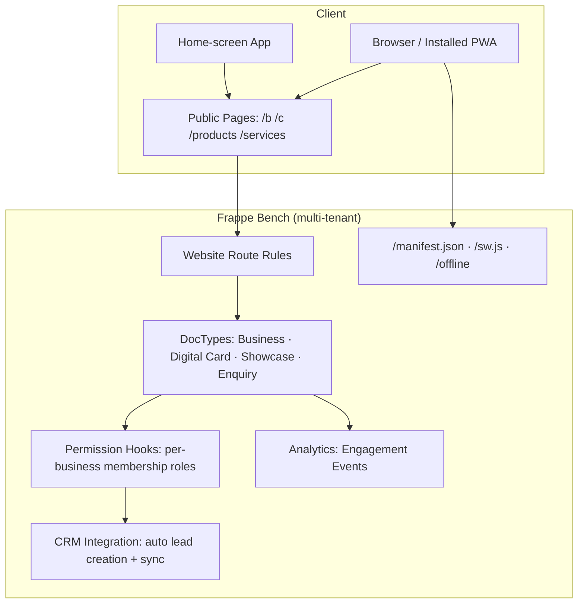

# OSDuo Business Connect

**v1.2.0** | **Your digital identity. Your customers. Your growth.**

Business Connect transforms how small businesses and professionals establish their digital presence. Create a stunning business profile, showcase products and services, capture customer enquiries, and install it all as a mobile app — all seamlessly integrated with Frappe CRM.

---

## What It Does

| Capability | Description |
|------------|-------------|
| **Digital Business Card** | Mobile-first card with VCF download, QR/NFC sharing, and 6 distinct templates |
| **Business Profile** | Public landing page with hero, about, products, services, hours, and contact |
| **Product Showcase** | Product catalog with categories, galleries, pricing, and brochures |
| **Service Listings** | Service pages with features, locations, and descriptions |
| **Lead Generation** | Enquiry forms that auto-create CRM leads with full tracking |
| **Analytics Dashboard** | Real-time engagement metrics — visits, scans, top cards, enquiry pipeline |
| **Mobile App (PWA)** | Every customer site installs as a branded app — offline card pages, home-screen icon |
| **Multi-Tenant SaaS** | One bench serves many customers on `customer.connect.domain.com` + bring-your-own domains |

---

## How It Works

```
Customer taps NFC / scans QR
         ↓

Business Connect Web App (installable PWA) → Profile loaded from database → Template rendered
         ↓
Customer fills enquiry form → Lead auto-created in Frappe CRM (with full tracking)
         ↓
Analytics Dashboard updates with real-time metrics
```

---

## Key Features

### Dynamic Card Generation
- **6 card templates** — Professional, Modern, Minimal, Classic, Luxury, Creative
- **QR code & NFC enabled** — QR auto-generated from the canonical public URL
- **VCF download** — complete digital business card sharing
- **Stable URLs** — the public slug locks on submit and survives cancel → amend, so printed
  QR codes and NFC tags never silently break

### Business Profile Management
- **Hero with real variants** — six distinct band/nav designs; cover image renders as a
  full-bleed banner behind the hero
- **About, products, services, business hours, contact, enquiry form** on the public page
- **Team members** — owner membership auto-created; add managers, marketing, members
- **Contact methods & social links** with sanitized public rendering

### Product Showcase & Service Listings
- Catalog with categories, galleries, pricing modes, brochures, and video embeds
- Detail pages inherit the parent business theme and header

### Theming & Branding
- **BC Theme**: template + layout + color scheme (Violet, Indigo, Blue, Green, Yellow, Orange,
  Red, Gold + custom) with automatic contrast correction and dark mode
- New businesses auto-link the built-in **Default Blue** theme

### Lead Generation Engine
- Enquiry forms capture visitor details and auto-create Frappe CRM leads with source,
  UTM campaign, and landing-URL tracking
- Enquiry pipeline with statuses and responses

### Analytics Dashboard
- Visits, card scans, engagement events (call/WhatsApp/email/brochure clicks), top cards,
  enquiry pipeline — real-time, guest-safe client-side tracking

### Progressive Web App (v1.2.0)
- `/manifest.json` — dynamic per-site app name, icons, and theme colors
- `/sw.js` — offline viewing of previously visited public pages, smart cache strategy
  (API and desk traffic never cached), automatic update roll-forward
- `/offline` — branded fallback page
- Android install prompt + iOS "Add to Home Screen" guidance on the login app entry
- See **[docs/PWA.md](docs/PWA.md)**

---

## Getting Started

### Prerequisites
- Frappe Framework **v16** (`>=16.0.0,<17.0.0`) and a working bench
- **Frappe CRM** (required dependency)
- Python 3.10+, Node.js/Yarn, MariaDB, Redis
- `qrcode[pil]` for QR generation: `bench pip install "qrcode[pil]"`

### Quick Install (single site)

```bash
bench init frappe-bench --frappe-branch version-16 && cd frappe-bench
bench new-site mysite.local
bench get-app https://github.com/devosduotech/osduo_business_connect.git
bench --site mysite.local install-app osduo_business_connect crm
bench --site mysite.local migrate
```

Then set the canonical domain in `sites/mysite.local/site_config.json` and restart:

```json
{ "host_name": "https://mysite.example.com" }
```

Full walkthrough — including **multi-tenant SaaS provisioning** (wildcard DNS, wildcard
TLS, per-customer sites, bring-your-own domains) and the update procedure:
**[docs/INSTALLATION_GUIDE.md](docs/INSTALLATION_GUIDE.md)**

---

## Documentation

| Document | Audience | Contents |
|---|---|---|
| [User Manual](docs/USER_MANUAL.md) | End users & admins | Businesses, cards, products, services, theming, publishing, enquiries, analytics, roles, mobile app |
| [Installation Guide](docs/INSTALLATION_GUIDE.md) | Operators | Fresh install, SaaS multi-site setup, BYOD domains, updates, troubleshooting |
| [PWA](docs/PWA.md) | Operators & devs | Manifest/service-worker architecture, caching strategy, canonical URL policy, testing |
| [SaaS Implementation Plan](docs/SAAS_IMPLEMENTATION_PLAN.md) | Product | Tiers, quotas, SEO engine — planned capabilities |
| [Theme Redesign Plan](docs/THEME_REDESIGN_PLAN.md) | Designers | Design system behind the public pages |
| [Marketing Features](docs/MARKETING_FEATURES.md) | Sales | Feature & benefit catalogue |
| [Release Notes](RELEASE_NOTES.md) / [Changelog](CHANGELOG.md) | Everyone | What shipped in each version |

---

## Architecture Overview



Security model: Business / Digital Card / Product / Service are **submittable** records;
public pages only serve Published + non-cancelled documents; rich text is sanitized on
save; all outbound links pass through `safe_url`; per-business data isolation is enforced
by `has_permission` + permission query conditions.

---

## Development Roadmap

- [x] Core business profile creation
- [x] Dynamic card generation with multiple templates
- [x] Frappe CRM integration for lead management
- [x] Analytics dashboard with real-time metrics
- [x] Mobile delivery via installable PWA (v1.2.0)
- [x] Multi-tenant SaaS domain model (hosted subdomains + BYOD)
- [ ] SaaS tiers & quotas (`BC Subscription`)
- [ ] SEO engine extensions (OG images, sitemap filters, keyword tracking)
- [ ] Web push notifications for installed PWAs
- [ ] Play Store listing via TWA wrappers
- [ ] Multi-language support

---

## Support & Contribution

For technical support, open an issue on the GitHub repository. For feature requests or bug reports, please use the appropriate issue template.

Contributions welcome! Review our contribution guidelines before submitting PRs.

---

**© 2026 OSDuo Technologies** | Licensed under MIT
