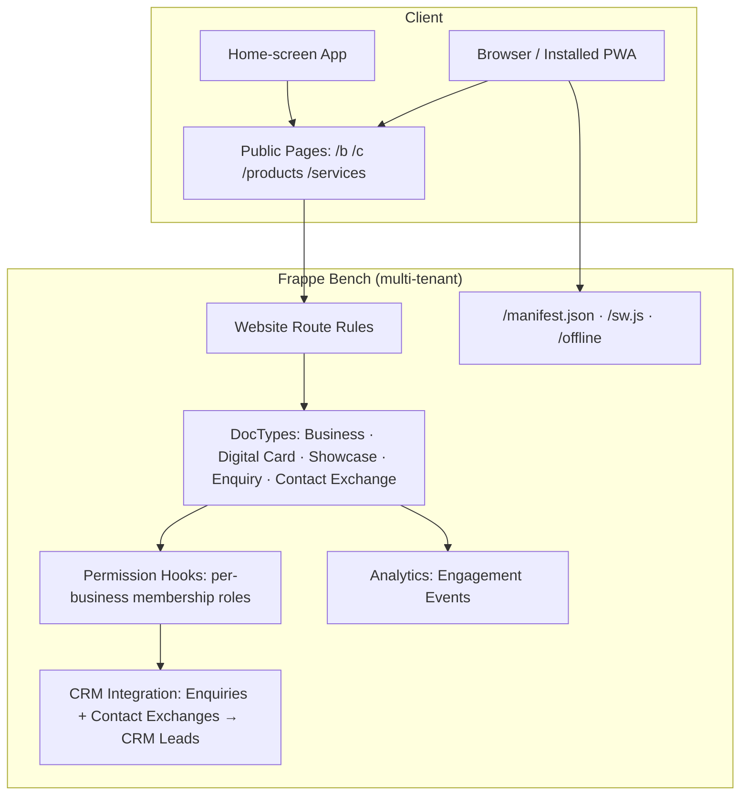

# OSDuo Business Connect

**v1.4.6** | **Your digital identity. Your customers. Your growth.**

Business Connect transforms how small businesses and professionals establish their digital presence. Create a stunning business profile, showcase products and services, capture customer enquiries and card exchanges, and install it all as a mobile app — all seamlessly integrated with Frappe CRM.

---

## What It Does

| Capability | Description |
|------------|-------------|
| **Digital Business Card** | Mobile-first card with VCF download, QR/NFC sharing, and 6 distinct templates |
| **Business Profile** | Public landing page with hero, about, products, services, hours, and contact |
| **Product Showcase** | Product catalog with categories, galleries, pricing, and brochures |
| **Service Listings** | Service pages with features, locations, and descriptions |
| **Lead Generation** | Enquiry forms and card exchanges that auto-create Enquiries, then CRM leads with full tracking |
| **Contact Exchange** | Owner records who a card/business/product was shared with at events — saved as an Enquiry, appears in CRM with the message context |
| **Universal Share Bar** | Copy / WhatsApp / SMS / Email / native share on every public page, tagged with standard `utm_*` + sharer; canonical URLs stay parameter-free |
| **My Card** | `/my-card` lists your published cards with one-tap Open, plus desk navbar / analytics entry points and an Open button beside Public URL in the desk forms |
| **Desk Support Links** | User Manual, Support Email and Support Portal in the Desk avatar and header menus; built-in Frappe help links removed |
| **Analytics Dashboard** | Real-time engagement metrics — visits, scans, top cards, visitor mix, enquiry pipeline |
| **Mobile App (PWA)** | Every customer site installs as a branded app — offline card pages, home-screen icon |
| **Multi-Tenant SaaS** | One bench serves many customers on `customer.connect.domain.com` + bring-your-own domains |

---

## How It Works

```
Customer taps NFC / scans QR
         ↓

Business Connect Web App (installable PWA) → Profile loaded from database → Template rendered
         ↓
Customer fills enquiry form → Lead auto-created in Frappe CRM (with full tracking)
         ↓
Analytics Dashboard updates with real-time metrics
```

---

## Key Features

### Dynamic Card Generation
- **6 card templates** — Professional, Modern, Minimal, Classic, Luxury, Creative
- **QR code & NFC enabled** — QR auto-generated from the canonical public URL
- **VCF download** — complete digital business card sharing
- **Stable URLs** — the public slug locks on submit and survives cancel → amend, so printed
  QR codes and NFC tags never silently break

### Business Profile Management
- **Hero with real variants** — six distinct band/nav designs; cover image renders as a
  full-bleed banner behind the hero
- **About, products, services, business hours, contact, enquiry form** on the public page
- **Team members** — owner membership auto-created; add managers, marketing, members
- **Contact methods & social links** with sanitized public rendering

### Product Showcase & Service Listings
- Catalog with categories, galleries, pricing modes, brochures, and video embeds
- Price display modes: Hidden, Contact for pricing, Fixed and **Start From**
  (a "From …" starting price) — formatted with thousands separators on the
  currency code (e.g. **INR 12,000**)
- Detail pages inherit the parent business theme and header

### Theming & Branding
- **BC Theme**: template + layout + color scheme (Violet, Indigo, Blue, Green, Yellow, Orange,
  Red, Gold + custom) with automatic contrast correction and dark mode
- New businesses auto-link the built-in **Default Blue** theme
- **Bundled logos**: login, desk/app screen and PWA icons all use brand assets that ship
  in the app (`public/images/`) — no copying logo files into each site's `public/files`;
  `bench migrate` applies the defaults and per-site uploads still override them
- **Default Website Theme**: `OSDuo Business Connect` ships with the app and is created +
  selected on install/migrate, together with the favicon, app logo and app name. Existing
  theme customisations and deliberate per-site theme choices are preserved

### Lead Generation Engine
- Enquiry forms capture visitor details and auto-create **Enquiries** that sync to
  Frappe CRM leads with source, UTM campaign, landing-URL tracking and the message
  carried onto the lead (`OSDuo Message`)
- **Contact Exchange (v1.2.5)** — a card handed over at an exhibition is recorded with
  the channel (WhatsApp/SMS/Email/In-person), event and notes; the CRM Lead keeps the
  context, and the "OSDuo Attribution" fields show on the CRM Lead side panel
  automatically
- Enquiry pipeline with statuses and responses

### Analytics Dashboard
- Visits, card scans, engagement events (call/WhatsApp/email/share-open/brochure
  clicks), top cards, enquiry pipeline — real-time, guest-safe client-side tracking
- **Visitor classification (v1.2.5)** — every event is stamped Guest / Owner / Member /
  Other User / Unknown from the live session; the dashboard shows the visitor mix and
  can exclude owner/member views so team testing doesn't inflate numbers

### Progressive Web App (v1.2.0)
- `/manifest.json` — dynamic per-site app name, icons, and theme colors
- `/sw.js` — offline viewing of previously visited public pages, smart cache strategy
  (API and desk traffic never cached), automatic update roll-forward
- `/offline` — branded fallback page
- Android install prompt + iOS "Add to Home Screen" guidance on the login app entry
- Details: see the **Mobile App (PWA)** section of the [User Manual](docs/USER_MANUAL.md)

### Sharing, Attribution & My Card (v1.2.5, UTM since v1.3.1)
- Canonical public URLs for QR/NFC safety — `host_name` honoured with its explicit
  scheme; scheme-less public hosts read as `https://` (no dev port on real domains)
- Share buttons carry standard `?utm_source=<channel>&utm_medium=share&by=<sharer's
  card slug>`; opening one logs a server-side `shared_link_open` event per channel.
  Legacy `?ref=share_*` links (already shared/printed) still attribute — canonical
  URLs themselves stay parameter-free
- `/my-card` page with one-tap card opening tagged `?utm_source=mycard`; desk "Open"
  button directly beside the Public URL on all profile forms (v1.2.6)

### Search Engine Discovery (v1.2.9)
- **Database-driven sitemaps**: `/sitemap.xml` is a sitemap index pointing at
  `/sitemap-businesses.xml`, `/sitemap-products.xml`, `/sitemap-services.xml`
  and `/sitemap-cards.xml`. Every URL is generated from live published records,
  carries an accurate `lastmod`, and excludes drafts/archived/unpublished items.
- **Correct origin per host**: sitemap and robots origins resolve `host_name`
  first, otherwise the served host — so each tenant subdomain lists its own
  `https://…` URLs with no per-site maintenance and no stale host baked in.
- **Dynamic `robots.txt`**: admin rules are respected; the `Sitemap:` line is
  rebuilt on every request so a wrong-host declaration can never leak.
- Refreshed on every publication change (event-based cache invalidation) plus a
  full regeneration every third day. Nothing is written to disk; the app never
  pushes to Google — crawlers discover the sitemap through `robots.txt`.

---

## Getting Started

### Prerequisites
- Frappe Framework **v16** (`>=16.0.0,<17.0.0`) and a working bench
- **Frappe CRM** (required dependency)
- Python 3.10+, Node.js/Yarn, MariaDB, Redis
- `qrcode[pil]` for QR generation: `bench pip install "qrcode[pil]"`

### Quick Install (single site)

```bash
bench init frappe-bench --frappe-branch version-16 && cd frappe-bench
bench new-site mysite.local
bench get-app https://github.com/devosduotech/osduo_business_connect.git
bench --site mysite.local install-app osduo_business_connect crm
bench --site mysite.local migrate
```

Then set the canonical domain in `sites/mysite.local/site_config.json` and restart:

```json
{ "host_name": "https://mysite.example.com" }
```

Full walkthrough — including **multi-tenant SaaS provisioning** (wildcard DNS, wildcard
TLS, per-customer sites, bring-your-own domains) and the update procedure:
**[docs/INSTALLATION_GUIDE.md](docs/INSTALLATION_GUIDE.md)**

---

## Release & Deployment

The repository keeps two long-lived branches so staging and production can be updated
independently:

| Branch | Deploys to | Purpose |
|---|---|---|
| `develop` | test / staging server | Integration branch — day-to-day work lands here first |
| `main` | live / production server | Release branch — only ever fast-forwarded from `develop` |

### Publish a release (run from the development machine)

```bash
git checkout main
git merge --ff-only develop     # main must only ever fast-forward
git push origin main develop
```

### Deploy to the live server

```bash
cd ~/connect-bench/apps/osduo_business_connect
git pull upstream main          # the remote is named origin on some clones
cd ~/connect-bench && bench restart
bench --site <site> clear-website-cache
```

### Update the test / staging server

```bash
cd ~/frappe-bench/apps/osduo_business_connect
git pull upstream develop
```

Run `bench migrate` and `bench build --app osduo_business_connect` **only** when a
release changes schema or bundled assets; docs-only releases just need a restart and a
website-cache clear.

> **After a history rewrite or force-push**, a normal pull reports *divergent branches*.
> Recover by resetting onto the rewritten refs — never by merging or rebasing:
> `git fetch --all --prune --tags --force` then `git reset --hard <remote>/<branch>`.

---

## Documentation

| Document | Audience | Contents |
|---|---|---|
| [User Manual](docs/USER_MANUAL.md) | End users & admins | Businesses, cards, products, services, theming, publishing, enquiries, analytics, roles, mobile app, subscriptions & add-ons |
| [Installation Guide](docs/INSTALLATION_GUIDE.md) | Operators | Fresh install, SaaS multi-site setup, BYOD domains, updates, troubleshooting |
| [Release Notes](RELEASE_NOTES.md) / [Changelog](CHANGELOG.md) | Everyone | What shipped in each version |

> Internal planning, marketing and architecture documents are maintained locally and
> are **not published** in this repository.

### Plan provisioning quick reference

One site = one customer = one Subscription = one plan. Run these commands from
the bench root with the bench Python environment. Billing is agreed in Aasriva;
the CLI only mirrors that decision locally. See the
[Installation Guide](docs/INSTALLATION_GUIDE.md#-site-provisioning-sop-new-customer-site)
for the full SOP, hostname rules and SMTP setup.

| Situation | Action |
|---|---|
| **New site, never provisioned** | Install apps, set `host_name`, then run `provision` **without** `--force`. |
| **Existing site upgraded to v1.4.x** | Run `bench migrate`; it auto-seeds **Business** only when the site already has business/user data. Verify, then provision manually if no plan was seeded. |
| **Existing site with a Subscription** | Re-run `provision` with `--force` to change or refresh the plan. This updates the frozen snapshot in place and never purges data. |

```bash
# Preview any plan change first
env/bin/python apps/osduo_business_connect/scripts/provision_customer_site.py \
  --site customer.example.com provision \
  --plan BUSINESS --seats 5 --dry-run

# Apply to a new/never-provisioned site
env/bin/python apps/osduo_business_connect/scripts/provision_customer_site.py \
  --site customer.example.com provision \
  --plan BUSINESS --seats 5 \
  --external-ref AASRIVA-ORDER-12345

# Change/refresh an already-provisioned site
env/bin/python apps/osduo_business_connect/scripts/provision_customer_site.py \
  --site customer.example.com provision \
  --plan ENTERPRISE --seats 10 \
  --external-ref AASRIVA-UPGRADE-12345 \
  --force

bench --site customer.example.com clear-cache
```

`--seats` defaults to the plan minimum and values below the minimum are
rejected. Changing `host_name` with `--hostname … --force` re-derives printed
QR/NFC URLs, so only do it after confirming the printed-media policy.

---

## Architecture Overview



Security model: Business / Digital Card / Product / Service are **submittable** records;
public pages only serve Published + non-cancelled documents; rich text is sanitized on
save; all outbound links pass through `safe_url`; per-business data isolation is enforced
by `has_permission` + permission query conditions.

---

## Development Roadmap

For the full pending to-do list (next release scope, backlog, tech debt and
documentation cleanups), see the project's local task list (not published in this
repository).

- [x] Core business profile creation
- [x] Dynamic card generation with multiple templates
- [x] Frappe CRM integration for lead management
- [x] Analytics dashboard with real-time metrics
- [x] Mobile delivery via installable PWA (v1.2.0)
- [x] Multi-tenant SaaS domain model (hosted subdomains + BYOD)
- [x] Universal share bar + channel/sharer attribution (v1.2.5)
- [x] Contact Exchange — event lead capture → Enquiry → CRM (v1.2.5)
- [x] Visitor classification & visitor-mix analytics (v1.2.5)
- [x] My Card: `/my-card`, desk navbar, Open buttons beside Public URL (v1.2.5/1.2.6)
- [x] Buy Here purchase links on products/services (v1.2.7) — per-item override +
      business default + analytics
- [x] Featured badges & featured-first ordering on all listings (v1.2.7)
- [x] Fullscreen product/service gallery lightbox — zoom, pan, pinch, swipe,
      keyboard navigation, and full gallery above Features (v1.2.8)
- [x] Database-driven sitemaps + dynamic `robots.txt` + "Start From" pricing
      with formatted currency (v1.2.9)
- [x] Video embed rendering fix — YouTube share links embed correctly; Nextcloud
      and direct video files play inline (v1.2.91)
- [x] Desk form layout baked into the app — every site gets the tidied forms on
      `migrate`, no Customize Form work (v1.2.92)
- [x] Even, symmetric section spacing on every public page — balanced top/bottom
      rhythm with no stray white space (v1.2.93)
- [x] SEO & brand attribution — canonical/OG + Twitter metadata, JSON-LD rich
      results, Product/Service SEO fields, Core Web Vitals (self-hosted fonts,
      inline SVG icons, split CSS, re-cut OG image), sitewide vendor footer and
      instant cache invalidation (v1.3.0; sitemap + robots shipped in v1.2.9)
- [x] Decision 12 — share links on standard `utm_*` (backward-compatible reader;
      canonical / printed QR·NFC URLs unchanged and parameter-free) (v1.3.1)
- [x] Desk support links in the avatar and header menus; Frappe help links removed
      (v1.3.2)
- [x] Theme & stability patch — business save cache fix, working font-size presets,
      correct shared hero logo sizing, selected colour honoured, transparent logos
      with no backdrop (v1.3.3)
- [x] Analytics patch — one view per visit, event/meeting used as Campaign
      (v1.3.4)
- [x] SaaS tiers & quotas — plan gates, frozen snapshots, seat/business caps,
      add-on orders, custom domains and read-only My Subscription (v1.4.0;
      the release UAT matrix is maintained locally with the planning docs)
- [x] Portal-only team invitations, shared private-page sidebar, branded login and
      root forwarding, and a portal-matched BC workspace that survives hard
      refresh (v1.4.0)
- [x] Plan-provisioning documentation for new/existing sites (v1.4.1), the
      first-migrate module-map fix (v1.4.2), a production-readiness cleanup
      (v1.4.3), the standard Business Connect Desk sidebar (v1.4.4), readable
      sidebar selection and authoritative theme pickers (v1.4.5), and
      scheme-driven public page headers (v1.4.6)
- [ ] Web push notifications for installed PWAs
- [ ] Play Store listing via TWA wrappers
- [ ] Multi-language support

---

## Known Issues

None currently.

---

## Support & Contribution

For technical support, open an issue on the GitHub repository. For feature requests or bug reports, please use the appropriate issue template.

Contributions welcome! Review our contribution guidelines before submitting PRs.

---

**© 2026 OSDuo Technologies** | Licensed under MIT
